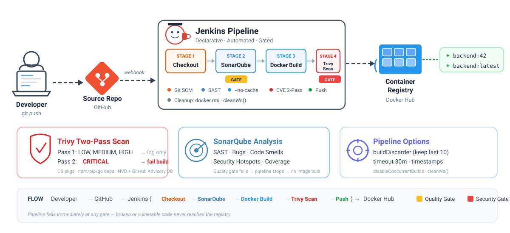

<p align="center">
  
  
  
  
  
</p>

# Jenkins CI/CD Pipeline — Docker Build & Push with Security Scanning

A production-grade Jenkins declarative pipeline that automates the entire lifecycle of the backend Docker image — from source code checkout to vulnerability scanning to registry push. Built with a **DevSecOps** mindset: code quality gates via SonarQube, container security scanning via Trivy, and clean image management in post-build cleanup.

> [!NOTE]
> Think of it as a factory assembly line — code goes in one end, and only a tested, scanned, and verified Docker image comes out the other.

---

## Pipeline Overview

<p align="center">
  
</p>

**`Stage 1` — CHECKOUT** &ensp; 

- Triggered automatically via **GitHub webhook** — every push to `main` kicks off a new build, zero manual intervention
- Pulls the latest source code using stored credentials. Single source of truth — every build starts from the same clean state

**`Stage 2` — SONARQUBE ANALYSIS** &ensp; 

- Runs **SAST** (Static Application Security Testing) on the backend source code — checks for bugs, code smells, and security hotspots
- Acts as the first quality gate — if coverage drops or critical issues are found, pipeline stops here itself. No point building an image from bad code

**`Stage 3` — DOCKER BUILD** &ensp; 

- Builds the backend Docker image tagged with Jenkins `BUILD_NUMBER` for traceability
- Uses `--no-cache` flag — fresh build every time, no stale cached layers sneaking in. Adds build time but guarantees reproducibility

**`Stage 4` — TRIVY SCAN** &ensp; 

- Two-pass vulnerability scan on the built image — first pass logs LOW to HIGH severity CVEs for team visibility, second pass **breaks the build** on any CRITICAL CVE
- This is the **shift-left security** approach — catch vulnerabilities at build time, not after it reaches production

**`Stage 5` — PUSH IMAGE** &ensp; 

- Only after both gates pass does the image get pushed to Docker Hub with an **immutable version tag** (`BUILD_NUMBER`) and a rolling `latest` tag
- Build number tag for production K8s manifests, `latest` as convenience for dev/staging

**`Post-Build` — CLEANUP** &ensp; 

- Removes the local Docker image and wipes the workspace — keeps the Jenkins agent lean, prevents disk bloat over time
- Runs on every build regardless of success or failure (`post { always }`)

<br>

<details>
<summary><b>How I'd Explain This in an Interview</b> (click to expand)</summary>
<br>

> *"We have a 5-stage declarative pipeline. Code gets pulled from Git, runs through SonarQube for static analysis and quality gate checks, then we build a Docker image. Before that image goes anywhere near a registry, Trivy scans it for known CVEs — we do a two-pass scan: first pass logs everything (LOW to HIGH), second pass fails the build on CRITICAL vulnerabilities. Only after all gates pass does the image get pushed to Docker Hub with both a version tag and latest. Post-build, we clean up the local image to keep the Jenkins agent lean."*

</details>

---

## CI/CD Setup

### Prerequisites

| Tool | Purpose | Install On |
|:-----|:--------|:-----------|
|  **Jenkins** | CI/CD orchestrator | Server / VM / Docker |
|  **Docker** | Container runtime | Jenkins server |
|  **SonarQube** | Static code analysis | Separate server / container |
|  **Trivy** | Container vulnerability scanner | Jenkins server |
| **sonar-scanner** | CLI to push analysis to SonarQube | Jenkins server |

### 1. Run Jenkins (Docker)

```bash
docker run -d \
  --name jenkins \
  --restart=on-failure \
  -p 8080:8080 \
  -p 50000:50000 \
  -v jenkins_home:/var/jenkins_home \
  -v /var/run/docker.sock:/var/run/docker.sock \
  jenkins/jenkins:lts-jdk21
```

| Flag | Purpose |
|:-----|:--------|
| `-p 8080:8080` | Jenkins web UI |
| `-p 50000:50000` | Agent communication (JNLP) |
| `-v jenkins_home:...` | Persists jobs, plugins, configs across restarts |
| `-v /var/run/docker.sock:...` | Lets Jenkins build Docker images on the host (DooD) |

After starting, get the initial admin password:

```bash
docker exec jenkins cat /var/jenkins_home/secrets/initialAdminPassword
```

### 2. Install Docker inside Jenkins container

Since the pipeline runs `docker.build()` and `docker.push()`, Docker CLI must be available inside the Jenkins container:

```bash
docker exec -u root jenkins bash -c "
  apt-get update && \
  apt-get install -y docker.io && \
  usermod -aG docker jenkins
"
docker restart jenkins
```

### 3. Install Trivy on Jenkins Server

```bash
docker exec -u root jenkins bash -c "
  apt-get install -y wget apt-transport-https gnupg lsb-release && \
  wget -qO - https://aquasecurity.github.io/trivy-repo/deb/public.key | gpg --dearmor -o /usr/share/keyrings/trivy.gpg && \
  echo 'deb [signed-by=/usr/share/keyrings/trivy.gpg] https://aquasecurity.github.io/trivy-repo/deb generic main' | tee /etc/apt/sources.list.d/trivy.list && \
  apt-get update && \
  apt-get install -y trivy
"
```

Verify:

```bash
docker exec jenkins trivy --version
```

### 4. Install SonarQube Scanner on Jenkins Server

```bash
docker exec -u root jenkins bash -c "
  wget -qO /tmp/sonar-scanner.zip https://binaries.sonarsource.com/Distribution/sonar-scanner-cli/sonar-scanner-cli-5.0.1.3006-linux.zip && \
  unzip /tmp/sonar-scanner.zip -d /opt && \
  ln -s /opt/sonar-scanner-5.0.1.3006-linux/bin/sonar-scanner /usr/local/bin/sonar-scanner && \
  rm /tmp/sonar-scanner.zip
"
```

### 5. Required Jenkins Plugins

> [!IMPORTANT]
> Install these from **Manage Jenkins > Plugins > Available plugins**

| Plugin Name | Search Keyword | Purpose |
|:------------|:---------------|:--------|
| **Docker Pipeline** | `docker-workflow` | `docker.build()`, `docker.withRegistry()` in Jenkinsfile |
| **Docker Commons** | `docker-commons` | Shared Docker credentials API (auto-installed with above) |
| **Pipeline** | `workflow-aggregator` | Core declarative pipeline engine |
| **Pipeline: Stage View** | `pipeline-stage-view` | Visual stage progress in Jenkins UI |
| **Git** | `git` | SCM checkout from GitHub |
| **SonarQube Scanner** | `sonar` | SonarQube integration & quality gate |
| **Credentials Binding** | `credentials-binding` | `withCredentials()` step for secrets |
| **Timestamper** | `timestamper` | `timestamps()` option — adds timestamps to console output |

### 6. Jenkins Credentials to Configure

> [!WARNING]
> Set these up **before** running the pipeline: **Manage Jenkins > Credentials > System > Global credentials**

| Credential ID | Type | What It Holds |
|:--------------|:-----|:--------------|
| `github` | Username with password | GitHub access (username + PAT) |
| `docker_hub` | Username with password | Docker Hub login credentials |
| `backend` | Secret text | SonarQube project token (`SONAR_TOKEN`) |

---

## Stages — Detailed Breakdown

### Stage 1: CHECKOUT &ensp; 

```groovy
stage('CHECKOUT') {
    steps {
        checkout([
            $class: 'GitSCM',
            branches: [[name: '*/main']],
            userRemoteConfigs: [[
                credentialsId: 'github',
                url: 'https://github.com/jaintpharsha/mern_3tire.git'
            ]]
        ])
    }
}
```

**What's happening:** Pulls the latest code from the `main` branch using stored GitHub credentials. In production, this is typically triggered by a **GitHub webhook** on push events — so every commit kicks off the pipeline automatically.

> [!TIP]
> **Interview note:** *"We use the GitSCM class directly instead of a simple `git` step because it gives us more control — we can specify credentials, branches, and polling strategies in a single block."*

---

### Stage 2: SONARQUBE ANALYSIS &ensp; 

```groovy
stage('SONARQUBE ANALYSIS') {
    steps {
        dir('./backend') {
            withCredentials([string(credentialsId: 'backend', variable: 'SONAR_TOKEN')]) {
                sh "sonar-scanner -Dsonar.host.url=${SONAR_HOST_URL}"
            }
        }
    }
}
```

**What's happening:** Runs `sonar-scanner` inside the `backend/` directory. The scanner picks up project config from `sonar-project.properties`, analyzes the code for bugs, code smells, security hotspots, and pushes results to the SonarQube server.

> [!TIP]
> **Interview note:** *"SonarQube acts as our quality gate. It does static application security testing (SAST), checks code coverage thresholds, and flags maintainability issues. If the quality gate fails — say coverage drops below 80% or critical bugs are found — the pipeline can be configured to stop right here."*

---

### Stage 3: DOCKER BUILD &ensp; 

```groovy
stage('DOCKER BUILD') {
    steps {
        script {
            dir('./backend') {
                backendImage = docker.build(
                    "${BACKEND_IMAGE}:${env.BUILD_NUMBER}",
                    "--no-cache -f ${DOCKERFILE} ."
                )
            }
        }
    }
}
```

**What's happening:** Builds the Docker image tagged with Jenkins' auto-incrementing `BUILD_NUMBER`. The `--no-cache` flag ensures a clean build every time — no stale cached layers sneaking in.

> [!TIP]
> **Interview note:** *"We tag with build number, not `latest`, for traceability. If something breaks in production, I can look at the running container's tag and immediately know which Jenkins build produced it. `--no-cache` adds build time but guarantees reproducibility."*

---

### Stage 4: TRIVY SCAN &ensp; 

```groovy
stage('TRIVY SCAN') {
    steps {
        // Pass 1: Log all vulnerabilities (informational)
        sh """
            trivy image \
                --severity LOW,MEDIUM,HIGH \
                --exit-code 0 \
                --format table \
                ${BACKEND_IMAGE}:${env.BUILD_NUMBER}
        """
        // Pass 2: Fail on CRITICAL (gate enforcement)
        sh """
            trivy image \
                --severity CRITICAL \
                --exit-code 1 \
                --format table \
                ${BACKEND_IMAGE}:${env.BUILD_NUMBER}
        """
    }
}
```

**What's happening:** Two-pass scanning strategy.

| Pass | Severity | Exit Code | Behaviour |
|:-----|:---------|:----------|:----------|
| **Pass 1** | LOW, MEDIUM, HIGH | `0` | Logs to console, **does not fail** the build |
| **Pass 2** | CRITICAL | `1` | **Fails the build** if any CRITICAL CVE is found |

> [!TIP]
> **Interview note:** *"We do a two-pass Trivy scan. First pass is informational — it logs LOW through HIGH vulnerabilities so the team has visibility in the build logs. Second pass is the gate — if there's a single CRITICAL CVE, the pipeline stops and the image never reaches the registry. This is the 'shift-left security' approach — catch vulnerabilities at build time, not in production."*

> [!NOTE]
> **What Trivy checks:**
> - OS-level packages (apt/apk/yum)
> - Application dependencies (npm, pip, go.mod, etc.)
> - Known CVEs from NVD, GitHub Security Advisories, and vendor databases

---

### Stage 5: PUSH IMAGE &ensp; 

```groovy
stage('PUSH IMAGE') {
    steps {
        script {
            docker.withRegistry('https://registry.hub.docker.com', 'docker_hub') {
                backendImage.push("${env.BUILD_NUMBER}")
                backendImage.push('latest')
            }
        }
    }
}
```

**What's happening:** Pushes the verified image to Docker Hub with two tags:

```diff
+ harshajain/backend:42       ← immutable version tag (build number)
+ harshajain/backend:latest   ← rolling tag for dev/staging
```

> [!TIP]
> **Interview note:** *"We push two tags. The build number tag is immutable — once pushed, it never changes. This is what we reference in Kubernetes manifests for production deployments. The `latest` tag is a convenience for development and staging where teams want to always pull the newest image."*

---

### Post-Build: Cleanup &ensp; 

```groovy
post {
    always {
        sh "docker rmi ${BACKEND_IMAGE}:${env.BUILD_NUMBER} || true"
        cleanWs()
    }
}
```

**What's happening:** Runs after every build (success or failure). Removes the locally built Docker image to prevent disk bloat on the Jenkins agent, then cleans the workspace.

> [!TIP]
> **Interview note:** *"The `post { always }` block ensures cleanup runs regardless of build outcome. We remove the local image because over time, accumulated images will eat up disk space on the Jenkins agent. `cleanWs()` removes the workspace so the next build starts fresh."*

---

## Pipeline Options Explained

```groovy
options {
    buildDiscarder(logRotator(numToKeepStr: '10'))   // Keep only last 10 builds
    timeout(time: 30, unit: 'MINUTES')                // Kill build if stuck > 30 min
    timestamps()                                       // Prefix console logs with timestamps
    disableConcurrentBuilds()                          // Queue builds, don't run in parallel
}
```

| Option | Why |
|:-------|:----|
| **buildDiscarder** | Prevents Jenkins from hoarding old build logs and artifacts |
| **timeout** | Safety net — kills hung builds (e.g., Docker pull stuck) |
| **timestamps** | Essential for debugging — "when exactly did it fail?" |
| **disableConcurrentBuilds** | Prevents race conditions when two commits push at the same time |

---

## Quick Reference — Interview Terminology

| Term | One-Liner |
|:-----|:----------|
| **CI (Continuous Integration)** | Automatically build and test every commit |
| **CD (Continuous Delivery)** | Automatically deploy validated code to staging/production |
| **DevSecOps** | Embedding security into every stage of the pipeline, not as an afterthought |
| **Shift-Left** | Moving testing and security earlier in the development lifecycle |
| **SAST** | Static Application Security Testing — analyzing source code without executing it (SonarQube) |
| **CVE** | Common Vulnerabilities and Exposures — standardized ID for known vulnerabilities |
| **Quality Gate** | A set of conditions code must pass before proceeding (coverage %, bug count, etc.) |
| **Immutable Tag** | A Docker tag that never changes once pushed (e.g., build number). Opposite of `latest` |
| **DooD** | Docker-out-of-Docker — mounting the host's Docker socket into Jenkins container |
| **Declarative Pipeline** | Jenkins pipeline syntax using `pipeline {}` blocks — structured, opinionated, readable |

---

## Full Pipeline Flow — Interview Whiteboard Version

```
  Developer pushes code
         │
         ▼
  ┌─── JENKINS PIPELINE ──────────────────────────────────────────────┐
  │                                                                    │
  │  [1] CHECKOUT ──▶ [2] SONARQUBE ──▶ [3] DOCKER BUILD             │
  │      (git pull)      (SAST scan)       (image create)             │
  │                         │                    │                     │
  │                    Quality Gate          ┌────▼─────┐              │
  │                    (pass/fail)           │ [4] TRIVY │             │
  │                                         │   SCAN    │             │
  │                                         └────┬─────┘              │
  │                                              │                     │
  │                                     Pass 1: Log LOW-HIGH          │
  │                                     Pass 2: Fail on CRITICAL      │
  │                                              │                     │
  │                                         ┌────▼─────┐              │
  │                                         │ [5] PUSH  │             │
  │                                         │   IMAGE   │             │
  │                                         └────┬─────┘              │
  │                                              │                     │
  │                                    Push BUILD_NUMBER + latest      │
  │                                              │                     │
  │  POST: docker rmi (cleanup) + cleanWs()      │                     │
  └──────────────────────────────────────────────┘                     │
                                                                       ▼
                                                              Docker Hub Registry
                                                           harshajain/backend:42
                                                           harshajain/backend:latest
```
