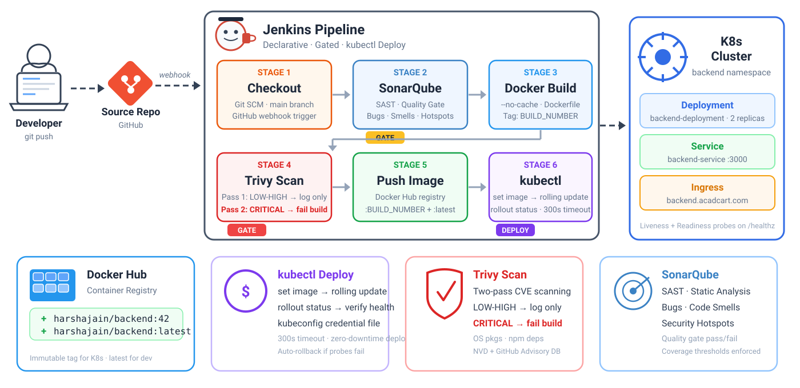

<p align="center">
  
  
  
  
  
  
</p>

# Jenkins CI/CD Pipeline — K8s Deployment via kubectl

A production-grade Jenkins declarative pipeline that builds, scans, and pushes the backend Docker image, then **directly deploys** to a Kubernetes cluster using `kubectl set image`. This is the **imperative approach** — Jenkins talks to the K8s API server directly, no GitOps middleware.

> [!NOTE]
> Think of it as the Docker Build pipeline with one extra stage — after the image passes all gates and lands in the registry, Jenkins immediately tells Kubernetes "use this new image" via `kubectl set image`, triggers a rolling update, and waits for the rollout to complete.

---

## Pipeline Overview

<p align="center">
  
</p>

**`Stage 1` — CHECKOUT** &ensp; 

- Triggered via **GitHub webhook** — every push to `main` kicks off a build, zero manual intervention
- Pulls the full repo using stored credentials. Same source for application code and K8s manifests

**`Stage 2` — SONARQUBE ANALYSIS** &ensp; 

- Runs **SAST** on the backend source code — bugs, code smells, security hotspots
- First quality gate — bad code never gets built into a container image

**`Stage 3` — DOCKER BUILD** &ensp; 

- Builds the backend image tagged with Jenkins `BUILD_NUMBER` for traceability
- `--no-cache` flag ensures reproducible builds every time

**`Stage 4` — TRIVY SCAN** &ensp; 

- Two-pass vulnerability scan — Pass 1 logs LOW-HIGH CVEs, Pass 2 **fails the build** on CRITICAL
- Shift-left security — catch vulnerabilities before the image reaches the registry or cluster

**`Stage 5` — PUSH IMAGE** &ensp; 

- Pushes to Docker Hub with an **immutable version tag** (`BUILD_NUMBER`) and rolling `latest` tag
- Only images that passed both SonarQube and Trivy gates make it here

**`Stage 6` — DEPLOY TO K8S** &ensp; 

- `kubectl set image` updates the deployment's container image to the new build number
- `kubectl rollout status` waits for the rolling update to complete (300s timeout) — verifies all new pods are healthy before marking success

**`Post-Build` — CLEANUP** &ensp; 

- Removes local Docker image and wipes workspace — keeps Jenkins agent lean
- Runs on every build regardless of outcome (`post { always }`)

<br>

<details>
<summary><b>How I'd Explain This in an Interview</b> (click to expand)</summary>
<br>

> *"We have a 6-stage declarative pipeline. Code gets pulled from Git, runs through SonarQube for static analysis, then we build a Docker image. Before pushing, Trivy does a two-pass CVE scan — first pass logs everything, second pass fails on CRITICAL. After the image reaches Docker Hub, we deploy directly to K8s using `kubectl set image` which triggers a rolling update. We then wait on `rollout status` to confirm all new pods are healthy. If any stage fails, the pipeline stops — broken or vulnerable code never reaches the cluster."*

</details>

---

## CI/CD Setup

### Prerequisites

| Tool | Purpose | Install On |
|:-----|:--------|:-----------|
|  **Jenkins** | CI/CD orchestrator | Server / VM / Docker |
|  **Docker** | Container runtime | Jenkins server |
|  **kubectl** | K8s CLI for deployments | Jenkins server |
|  **SonarQube** | Static code analysis | Separate server / container |
|  **Trivy** | Container vulnerability scanner | Jenkins server |
| **sonar-scanner** | CLI to push analysis to SonarQube | Jenkins server |

### 1. Run Jenkins (Docker)

```bash
docker run -d \
  --name jenkins \
  --restart=on-failure \
  -p 8080:8080 \
  -p 50000:50000 \
  -v jenkins_home:/var/jenkins_home \
  -v /var/run/docker.sock:/var/run/docker.sock \
  jenkins/jenkins:lts-jdk21
```

### 2. Install Docker + kubectl inside Jenkins

```bash
docker exec -u root jenkins bash -c "
  apt-get update && \
  apt-get install -y docker.io curl && \
  usermod -aG docker jenkins && \
  curl -LO https://dl.k8s.io/release/\$(curl -Ls https://dl.k8s.io/release/stable.txt)/bin/linux/amd64/kubectl && \
  chmod +x kubectl && mv kubectl /usr/local/bin/
"
docker restart jenkins
```

### 3. Install Trivy + sonar-scanner

```bash
# Trivy
docker exec -u root jenkins bash -c "
  apt-get install -y wget apt-transport-https gnupg lsb-release && \
  wget -qO - https://aquasecurity.github.io/trivy-repo/deb/public.key | gpg --dearmor -o /usr/share/keyrings/trivy.gpg && \
  echo 'deb [signed-by=/usr/share/keyrings/trivy.gpg] https://aquasecurity.github.io/trivy-repo/deb generic main' | tee /etc/apt/sources.list.d/trivy.list && \
  apt-get update && apt-get install -y trivy
"

# SonarQube Scanner
docker exec -u root jenkins bash -c "
  wget -qO /tmp/sonar-scanner.zip https://binaries.sonarsource.com/Distribution/sonar-scanner-cli/sonar-scanner-cli-5.0.1.3006-linux.zip && \
  unzip /tmp/sonar-scanner.zip -d /opt && \
  ln -s /opt/sonar-scanner-5.0.1.3006-linux/bin/sonar-scanner /usr/local/bin/sonar-scanner && \
  rm /tmp/sonar-scanner.zip
"
```

### 4. Required Jenkins Plugins

> [!IMPORTANT]
> Install from **Manage Jenkins > Plugins > Available plugins**

| Plugin Name | Search Keyword | Purpose |
|:------------|:---------------|:--------|
| **Docker Pipeline** | `docker-workflow` | `docker.build()`, `docker.withRegistry()` |
| **Pipeline** | `workflow-aggregator` | Core declarative pipeline engine |
| **Git** | `git` | SCM checkout from GitHub |
| **SonarQube Scanner** | `sonar` | SonarQube integration |
| **Credentials Binding** | `credentials-binding` | `withCredentials()` for secrets |
| **Timestamper** | `timestamper` | Adds timestamps to console output |

### 5. Jenkins Credentials

> [!WARNING]
> Set these up **before** running the pipeline: **Manage Jenkins > Credentials > System > Global credentials**

| Credential ID | Type | What It Holds |
|:--------------|:-----|:--------------|
| `github` | Username with password | GitHub access (username + PAT) |
| `docker_hub` | Username with password | Docker Hub login credentials |
| `backend` | Secret text | SonarQube project token (`SONAR_TOKEN`) |
| `kubeconfig` | Secret file | Kubernetes config file (`~/.kube/config`) |

> [!TIP]
> **Interview note:** *"The kubeconfig is stored as a Jenkins 'Secret file' credential. When the pipeline runs, it mounts the file temporarily and sets the `KUBECONFIG` environment variable — so kubectl knows which cluster to talk to without hardcoding anything."*

---

## Stages — Detailed Breakdown

### Stage 1: CHECKOUT &ensp; 

```groovy
stage('CHECKOUT') {
    steps {
        checkout([
            $class: 'GitSCM',
            branches: [[name: '*/main']],
            userRemoteConfigs: [[
                credentialsId: 'github',
                url: 'https://github.com/jaintpharsha/mern_3tire.git'
            ]]
        ])
    }
}
```

**What's happening:** Pulls latest code from the `main` branch. The same repo contains both the backend application code and K8s manifests.

> [!TIP]
> **Interview note:** *"We checkout the full repo because the application source and Kubernetes manifests live in the same monorepo. The backend code goes through the build pipeline, and the K8s manifests are available if we need to reference or update them."*

---

### Stage 2: SONARQUBE ANALYSIS &ensp; 

```groovy
stage('SONARQUBE ANALYSIS') {
    steps {
        dir('./backend') {
            withCredentials([string(credentialsId: 'backend', variable: 'SONAR_TOKEN')]) {
                sh "sonar-scanner -Dsonar.host.url=${SONAR_HOST_URL}"
            }
        }
    }
}
```

**What's happening:** Runs `sonar-scanner` on the `backend/` directory. Checks for bugs, code smells, security hotspots, and coverage against quality gate thresholds.

> [!TIP]
> **Interview note:** *"SonarQube is our SAST (Static Application Security Testing) tool. It analyzes the source code without running it — looking for bugs, vulnerabilities, code smells. If the quality gate fails, the pipeline stops here. No point building an image from code that doesn't pass quality checks."*

---

### Stage 3: DOCKER BUILD &ensp; 

```groovy
stage('DOCKER BUILD') {
    steps {
        script {
            dir('./backend') {
                backendImage = docker.build(
                    "${BACKEND_IMAGE}:${env.BUILD_NUMBER}",
                    "--no-cache -f ${DOCKERFILE} ."
                )
            }
        }
    }
}
```

**What's happening:** Builds the Docker image with Jenkins' `BUILD_NUMBER` as the tag. `--no-cache` guarantees a fresh build every time.

> [!TIP]
> **Interview note:** *"We tag with build number for traceability. If a pod is running `backend:42`, I know exactly which Jenkins build produced it. The `--no-cache` flag trades build time for reproducibility — no stale cached layers."*

---

### Stage 4: TRIVY SCAN &ensp; 

```groovy
stage('TRIVY SCAN') {
    steps {
        sh """
            trivy image \
                --severity LOW,MEDIUM,HIGH \
                --exit-code 0 \
                --format table \
                ${BACKEND_IMAGE}:${env.BUILD_NUMBER}
        """
        sh """
            trivy image \
                --severity CRITICAL \
                --exit-code 1 \
                --format table \
                ${BACKEND_IMAGE}:${env.BUILD_NUMBER}
        """
    }
}
```

**What's happening:** Two-pass scanning strategy.

| Pass | Severity | Exit Code | Behaviour |
|:-----|:---------|:----------|:----------|
| **Pass 1** | LOW, MEDIUM, HIGH | `0` | Logs to console, **does not fail** |
| **Pass 2** | CRITICAL | `1` | **Fails the build** — image never reaches the cluster |

> [!TIP]
> **Interview note:** *"This is shift-left security. We scan the image before it goes anywhere near the registry or cluster. A two-pass approach gives us visibility on lower severity CVEs while hard-blocking on CRITICAL ones."*

---

### Stage 5: PUSH IMAGE &ensp; 

```groovy
stage('PUSH IMAGE') {
    steps {
        script {
            docker.withRegistry('https://registry.hub.docker.com', 'docker_hub') {
                backendImage.push("${env.BUILD_NUMBER}")
                backendImage.push('latest')
            }
        }
    }
}
```

**What's happening:** Pushes the verified image with two tags:

```diff
+ harshajain/backend:42       ← immutable tag for K8s deployment
+ harshajain/backend:latest   ← rolling tag for dev/staging
```

---

### Stage 6: DEPLOY TO K8S &ensp; 

```groovy
stage('DEPLOY TO K8S') {
    steps {
        withCredentials([file(credentialsId: 'kubeconfig', variable: 'KUBECONFIG')]) {
            sh """
                kubectl set image deployment/${DEPLOYMENT} \
                    backend=${BACKEND_IMAGE}:${env.BUILD_NUMBER} \
                    -n ${K8S_NAMESPACE}
            """
            sh "kubectl rollout status deployment/${DEPLOYMENT} -n ${K8S_NAMESPACE} --timeout=300s"
        }
    }
}
```

**What's happening:**

1. **`kubectl set image`** — Updates the deployment's container image to the new build number. This triggers a **rolling update** — K8s gradually replaces old pods with new ones, maintaining availability.

2. **`kubectl rollout status`** — Waits up to 300 seconds for the rollout to complete. If new pods fail health checks, this command exits non-zero and the pipeline fails.

> [!TIP]
> **Interview note:** *"We use `kubectl set image` which is the imperative approach — Jenkins directly tells K8s to update the image. This triggers a rolling update strategy defined in the deployment spec. The `rollout status` command is our deployment gate — if the new pods don't pass readiness probes within 5 minutes, the pipeline fails and K8s automatically rolls back to the previous version."*

> [!NOTE]
> **Why kubectl approach vs GitOps?**
> - **Simpler** — no additional tooling (no ArgoCD, no Flux)
> - **Faster** — no git commit + sync delay, deployment happens immediately
> - **Trade-off** — less auditable, K8s state can drift from Git. For production, GitOps (Helm + ArgoCD) is preferred

---

### Post-Build: Cleanup &ensp; 

```groovy
post {
    always {
        sh "docker rmi ${BACKEND_IMAGE}:${env.BUILD_NUMBER} || true"
        cleanWs()
    }
}
```

**What's happening:** Removes the local Docker image and cleans the workspace. Runs after every build regardless of outcome.

---

## Pipeline Options Explained

```groovy
options {
    buildDiscarder(logRotator(numToKeepStr: '10'))
    timeout(time: 30, unit: 'MINUTES')
    timestamps()
    disableConcurrentBuilds()
}
```

| Option | Why |
|:-------|:----|
| **buildDiscarder** | Keep only last 10 builds — prevents disk bloat |
| **timeout** | Kill hung builds after 30 minutes |
| **timestamps** | Prefix console logs with timestamps for debugging |
| **disableConcurrentBuilds** | Prevent race conditions when two pushes happen simultaneously |

---

## Quick Reference — Interview Terminology

| Term | One-Liner |
|:-----|:----------|
| **Imperative Deploy** | Directly telling K8s what to do (`kubectl set image`). Opposite of declarative/GitOps |
| **Rolling Update** | K8s gradually replaces old pods with new ones, maintaining availability during deploy |
| **Rollout Status** | `kubectl rollout status` — blocks until the rolling update completes or fails |
| **kubeconfig** | Config file that tells kubectl which cluster to talk to (server URL, auth, context) |
| **Shift-Left** | Moving testing and security earlier in the development lifecycle |
| **SAST** | Static Application Security Testing — analyzing source code without executing it |
| **CVE** | Common Vulnerabilities and Exposures — standardized ID for known vulnerabilities |
| **Immutable Tag** | Docker tag that never changes once pushed (build number vs `latest`) |
| **Namespace** | K8s isolation boundary — `backend` namespace separates backend pods from frontend/database |
| **Readiness Probe** | K8s health check that determines if a pod is ready to receive traffic |

---

## Full Pipeline Flow — Interview Whiteboard Version

```
  Developer pushes code
         │
         ▼
  ┌─── JENKINS PIPELINE ──────────────────────────────────────────────┐
  │                                                                    │
  │  [1] CHECKOUT ──▶ [2] SONARQUBE ──▶ [3] DOCKER BUILD             │
  │      (git pull)      (SAST scan)       (image create)             │
  │                         │                    │                     │
  │                    Quality Gate          ┌────▼─────┐              │
  │                    (pass/fail)           │ [4] TRIVY │             │
  │                                         │   SCAN    │             │
  │                                         └────┬─────┘              │
  │                                              │                     │
  │                                     Pass 1: Log LOW-HIGH          │
  │                                     Pass 2: Fail on CRITICAL      │
  │                                              │                     │
  │                                         ┌────▼─────┐              │
  │                                         │ [5] PUSH  │             │
  │                                         │   IMAGE   │             │
  │                                         └────┬─────┘              │
  │                                              │                     │
  │                                    Push BUILD_NUMBER + latest      │
  │                                              │                     │
  │                                         ┌────▼──────┐             │
  │                                         │ [6] DEPLOY │             │
  │                                         │  kubectl   │             │
  │                                         └────┬──────┘             │
  │                                              │                     │
  │                                    set image + rollout status      │
  │                                              │                     │
  │  POST: docker rmi (cleanup) + cleanWs()      │                     │
  └──────────────────────────────────────────────┘                     │
                                                                       ▼
                                                              K8s Cluster
                                                         backend namespace
                                                      backend-deployment:42
                                                         (2 replicas)
```
