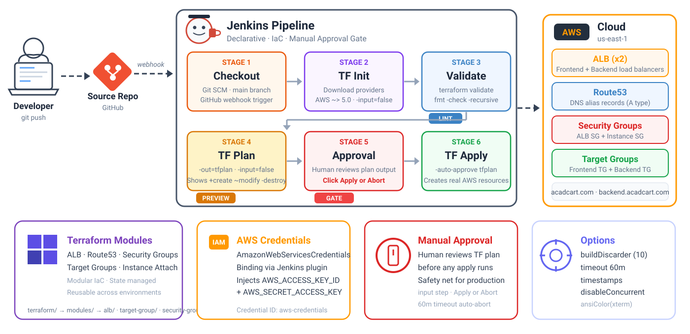

<p align="center">
  
  
  
  
  
</p>

# Jenkins CI/CD Pipeline — Terraform Infrastructure Provisioning

A production-grade Jenkins declarative pipeline that automates **AWS infrastructure provisioning** using Terraform. The pipeline follows the standard IaC workflow — init, validate, plan, **manual approval**, apply — with proper credential management and safety gates. Built for provisioning ALBs, Route53 DNS, Security Groups, and Target Groups that front the K8s cluster.

> [!NOTE]
> Unlike the Docker Build or K8s pipelines, this pipeline modifies **real cloud infrastructure**. That's why there's a mandatory **manual approval gate** between `plan` and `apply` — a human reviews the change set before any resource gets created, modified, or destroyed.

---

## Pipeline Overview

<p align="center">
  
</p>

**`Stage 1` — CHECKOUT** &ensp; 

- Pulls the full repo including the `terraform/` directory with all modules
- Triggered via **GitHub webhook** on push to `main`

**`Stage 2` — TERRAFORM INIT** &ensp; 

- Initializes the Terraform working directory — downloads providers (AWS ~> 5.0, Null ~> 3.0)
- Downloads and caches module dependencies. `-input=false` prevents interactive prompts

**`Stage 3` — TERRAFORM VALIDATE** &ensp; 

- `terraform validate` checks HCL syntax and configuration for errors
- `terraform fmt -check` ensures code follows canonical Terraform formatting — fails if files aren't properly formatted

**`Stage 4` — TERRAFORM PLAN** &ensp; 

- Generates an execution plan showing exactly what will be created, changed, or destroyed
- Saved to `tfplan` file — this exact plan is what gets applied (no surprises between plan and apply)

**`Stage 5` — APPROVAL** &ensp; 

- **Manual approval gate** — pipeline pauses and waits for a human to review the plan output
- This is the safety net — prevents accidental infrastructure changes from auto-applying

**`Stage 6` — TERRAFORM APPLY** &ensp; 

- Applies the exact plan from Stage 4 — `-auto-approve` is safe here because we're applying a saved plan file, not running a fresh plan
- Creates/modifies/destroys AWS resources as shown in the plan

**`Post-Build` — CLEANUP** &ensp; 

- Removes the `tfplan` file and cleans workspace
- Runs on every build regardless of outcome

<br>

<details>
<summary><b>How I'd Explain This in an Interview</b> (click to expand)</summary>
<br>

> *"We use a Jenkins pipeline to manage our AWS infrastructure as code with Terraform. The pipeline has 6 stages: checkout the repo, terraform init to download providers and modules, validate to check syntax and formatting, plan to generate the execution plan, manual approval where a team lead reviews what's about to change, and finally apply. The critical piece is the manual approval gate — since we're modifying real cloud infrastructure (ALBs, DNS records, security groups), we never auto-apply. The plan output shows exactly what will be created, changed, or destroyed, and a human must explicitly approve before anything touches AWS. This prevents accidental deletions or misconfigurations from reaching production."*

</details>

---

## CI/CD Setup

### Prerequisites

| Tool | Purpose | Install On |
|:-----|:--------|:-----------|
|  **Jenkins** | CI/CD orchestrator | Server / VM / Docker |
|  **Terraform** (>= 1.0) | Infrastructure as Code CLI | Jenkins server |
|  **AWS CLI** (optional) | For debugging/verification | Jenkins server |

### 1. Run Jenkins (Docker)

```bash
docker run -d \
  --name jenkins \
  --restart=on-failure \
  -p 8080:8080 \
  -p 50000:50000 \
  -v jenkins_home:/var/jenkins_home \
  jenkins/jenkins:lts-jdk21
```

> [!NOTE]
> No Docker socket mount needed — this pipeline doesn't build containers. It only runs Terraform.

### 2. Install Terraform inside Jenkins

```bash
docker exec -u root jenkins bash -c "
  apt-get update && apt-get install -y wget unzip && \
  wget -qO /tmp/terraform.zip https://releases.hashicorp.com/terraform/1.7.0/terraform_1.7.0_linux_amd64.zip && \
  unzip /tmp/terraform.zip -d /usr/local/bin/ && \
  rm /tmp/terraform.zip
"
```

Verify:

```bash
docker exec jenkins terraform --version
```

### 3. Required Jenkins Plugins

> [!IMPORTANT]
> Install from **Manage Jenkins > Plugins > Available plugins**

| Plugin Name | Search Keyword | Purpose |
|:------------|:---------------|:--------|
| **Pipeline** | `workflow-aggregator` | Core declarative pipeline engine |
| **Git** | `git` | SCM checkout from GitHub |
| **Credentials Binding** | `credentials-binding` | `withCredentials()` for AWS secrets |
| **Pipeline: AWS Steps** | `pipeline-aws` | `AmazonWebServicesCredentialsBinding` |
| **Timestamper** | `timestamper` | Adds timestamps to console output |
| **AnsiColor** | `ansicolor` | Colored Terraform output in console |

### 4. Jenkins Credentials

> [!WARNING]
> Set these up **before** running the pipeline: **Manage Jenkins > Credentials > System > Global credentials**

| Credential ID | Type | What It Holds |
|:--------------|:-----|:--------------|
| `github` | Username with password | GitHub access (username + PAT) |
| `aws-credentials` | AWS Credentials | AWS Access Key ID + Secret Access Key |

> [!TIP]
> **Interview note:** *"We use the AmazonWebServicesCredentialsBinding plugin which injects `AWS_ACCESS_KEY_ID` and `AWS_SECRET_ACCESS_KEY` as environment variables during the pipeline run. Terraform automatically picks these up — no hardcoded credentials in code."*

### 5. AWS Prerequisites (before first run)

These must exist **before** running the Terraform pipeline:

| AWS Resource | Why |
|:-------------|:----|
| **ACM Certificates** | SSL/TLS certs for `acadcart.com` and `backend.acadcart.com` |
| **Route53 Hosted Zone** | DNS zone for `acadcart.com` domain |
| **EC2 Instances** | K8s nodes tagged with `Jenkins=k8s` for target group attachment |
| **Default VPC** | Terraform uses default VPC if no custom VPC specified |

---

## Stages — Detailed Breakdown

### Stage 1: CHECKOUT &ensp; 

```groovy
stage('CHECKOUT') {
    steps {
        checkout([
            $class: 'GitSCM',
            branches: [[name: '*/main']],
            userRemoteConfigs: [[
                credentialsId: 'github',
                url: 'https://github.com/jaintpharsha/mern_3tire.git'
            ]]
        ])
    }
}
```

**What's happening:** Pulls the full repo. The Terraform code lives in the `terraform/` directory with a modular structure.

---

### Stage 2: TERRAFORM INIT &ensp; 

```groovy
stage('TERRAFORM INIT') {
    steps {
        dir("${TF_DIR}") {
            withCredentials([[$class: 'AmazonWebServicesCredentialsBinding', credentialsId: 'aws-credentials']]) {
                sh "terraform init -input=false"
            }
        }
    }
}
```

**What's happening:** Initializes the working directory — downloads AWS provider (~> 5.0), Null provider (~> 3.0), and prepares the backend state. `-input=false` prevents Terraform from prompting for input (critical for CI).

> [!TIP]
> **Interview note:** *"`terraform init` is like `npm install` for infrastructure. It downloads the required providers (AWS, Null) and initializes the state backend. The `-input=false` flag is essential in CI — without it, Terraform might prompt for user input and hang the pipeline."*

---

### Stage 3: TERRAFORM VALIDATE &ensp; 

```groovy
stage('TERRAFORM VALIDATE') {
    steps {
        dir("${TF_DIR}") {
            sh "terraform validate"
            sh "terraform fmt -check -recursive"
        }
    }
}
```

**What's happening:** Two checks:

1. **`validate`** — Checks HCL syntax, variable declarations, resource references, and provider compatibility
2. **`fmt -check`** — Verifies all `.tf` files follow canonical Terraform formatting. Fails if anyone committed unformatted code

> [!TIP]
> **Interview note:** *"This is our linting gate. `validate` catches syntax errors and broken references before we even talk to AWS. `fmt -check` enforces consistent code style — if a developer commits unformatted Terraform code, the pipeline fails here. This is like ESLint for infrastructure code."*

---

### Stage 4: TERRAFORM PLAN &ensp; 

```groovy
stage('TERRAFORM PLAN') {
    steps {
        dir("${TF_DIR}") {
            withCredentials([[$class: 'AmazonWebServicesCredentialsBinding', credentialsId: 'aws-credentials']]) {
                sh "terraform plan -out=tfplan -input=false"
            }
        }
    }
}
```

**What's happening:** Generates a detailed execution plan showing:
- Resources to be **created** (green `+`)
- Resources to be **modified** (yellow `~`)
- Resources to be **destroyed** (red `-`)

The plan is saved to `tfplan` file — this exact plan is what gets applied in Stage 6.

> [!TIP]
> **Interview note:** *"The `-out=tfplan` flag is critical for production pipelines. It saves the exact execution plan to a file. When we apply in a later stage, we apply THIS specific plan — not a new one. This prevents the 'time-of-check to time-of-use' problem where infrastructure state might change between plan and apply."*

---

### Stage 5: APPROVAL &ensp; 

```groovy
stage('APPROVAL') {
    steps {
        input message: 'Review the Terraform plan above. Approve to apply?', ok: 'Apply'
    }
}
```

**What's happening:** Pipeline pauses and shows an "Apply" / "Abort" dialog in Jenkins UI. A human must review the plan output from Stage 4 and explicitly approve.

> [!TIP]
> **Interview note:** *"This is our infrastructure safety net. Unlike application deployments where we might auto-deploy, infrastructure changes can be destructive — a wrong plan could delete a production load balancer or DNS record. The `input` step requires a human with Jenkins access to review the plan and click 'Apply'. If they don't approve within the pipeline timeout (60 minutes), the build auto-aborts."*

> [!WARNING]
> **In production:** Consider restricting who can approve. Use the `submitter` parameter: `input message: '...', ok: 'Apply', submitter: 'admin,devops-lead'`

---

### Stage 6: TERRAFORM APPLY &ensp; 

```groovy
stage('TERRAFORM APPLY') {
    steps {
        dir("${TF_DIR}") {
            withCredentials([[$class: 'AmazonWebServicesCredentialsBinding', credentialsId: 'aws-credentials']]) {
                sh "terraform apply -auto-approve tfplan"
            }
        }
    }
}
```

**What's happening:** Applies the saved plan file. `-auto-approve` is safe here because:
1. We're applying a **saved plan** (`tfplan`), not running a fresh plan
2. A human already approved the exact changes in Stage 5
3. Terraform will error if the state has drifted since the plan was created

> [!TIP]
> **Interview note:** *"`-auto-approve` looks dangerous but it's actually safe here because we're applying a saved plan file, not running `apply` bare. The plan was already human-approved. If the infrastructure state changed since we ran the plan, Terraform will detect the drift and refuse to apply."*

---

### Post-Build: Cleanup

```groovy
post {
    always {
        dir("${TF_DIR}") {
            sh "rm -f tfplan"
        }
        cleanWs()
    }
}
```

**What's happening:** Removes the `tfplan` file (may contain sensitive data) and cleans workspace.

---

## Infrastructure Managed — What Terraform Creates

### Module Architecture

```
terraform/
├── provider.tf              ← AWS provider, default tags
├── variables.tf             ← All input variables
├── main.tf                  ← Orchestration (wires modules together)
├── outputs.tf               ← URLs, ARNs, IDs
└── modules/
    ├── alb/                 ← Application Load Balancer + listeners
    ├── target-group/        ← Target groups + instance attachment
    ├── security-group/      ← Ingress/egress rules
    └── route53/             ← DNS records (A alias)
```

### AWS Resources Provisioned

| Resource | Count | Details |
|:---------|:------|:--------|
| **ALB** | 2 | Frontend ALB (`acadcart.com`) + Backend ALB (`backend.acadcart.com`) |
| **Listeners** | 4 | HTTP→HTTPS redirect + HTTPS→Target Group (per ALB) |
| **Target Groups** | 2 | Frontend TG (port 32580) + Backend TG (port 32580) |
| **Security Groups** | 2 | ALB SG (80/443 from internet) + Instance SG (NodePorts from ALB) |
| **Route53 Records** | 3 | `acadcart.com` + `www.acadcart.com` + `backend.acadcart.com` |

### Traffic Flow

```
Internet → Route53 DNS → ALB (HTTPS termination) → Target Group → K8s NodePort (32580)
                                                                        │
                                                                  NGINX Ingress
                                                                        │
                                                               Backend/Frontend Pods
```

> [!TIP]
> **Interview note:** *"Terraform provisions the networking layer that sits in front of Kubernetes. Route53 handles DNS, ALBs terminate SSL using ACM certificates, and target groups route traffic to the K8s node's NGINX Ingress Controller NodePort. The K8s cluster itself is managed separately — Terraform only handles the AWS networking infrastructure."*

---

## Pipeline Options Explained

```groovy
options {
    buildDiscarder(logRotator(numToKeepStr: '10'))
    timeout(time: 60, unit: 'MINUTES')
    timestamps()
    disableConcurrentBuilds()
    ansiColor('xterm')
}
```

| Option | Why |
|:-------|:----|
| **buildDiscarder** | Keep only last 10 builds |
| **timeout (60m)** | Longer timeout — includes human approval wait time |
| **timestamps** | Timestamps in console for debugging |
| **disableConcurrentBuilds** | Prevent parallel Terraform runs (state locking) |
| **ansiColor** | Colored Terraform output (green for create, red for destroy) |

> [!NOTE]
> The 60-minute timeout is intentional — the `input` step waits for human approval. If nobody approves within 60 minutes, the pipeline auto-aborts safely.

---

## Quick Reference — Interview Terminology

| Term | One-Liner |
|:-----|:----------|
| **IaC** | Infrastructure as Code — managing cloud resources through version-controlled code |
| **Terraform** | HashiCorp's IaC tool — declarative, provider-based, state-managed |
| **HCL** | HashiCorp Configuration Language — Terraform's DSL |
| **State File** | `terraform.tfstate` — Terraform's record of what it manages in the real world |
| **Plan** | Preview of what Terraform will do — create, modify, destroy |
| **Module** | Reusable Terraform package (like a function for infrastructure) |
| **Provider** | Plugin that talks to a cloud API (AWS, GCP, Azure) |
| **ALB** | Application Load Balancer — Layer 7 load balancer for HTTP/HTTPS traffic |
| **Route53** | AWS DNS service — maps domain names to ALB endpoints |
| **Target Group** | ALB routing destination — group of instances that receive traffic |
| **Security Group** | AWS firewall — controls inbound/outbound traffic rules |
| **ACM** | AWS Certificate Manager — free SSL/TLS certificates for ALBs |
| **Drift** | When real infrastructure differs from what Terraform expects |
| **Idempotent** | Running Terraform apply twice with same config produces same result |

---

## Full Pipeline Flow — Interview Whiteboard Version

```
  Developer pushes Terraform code
         │
         ▼
  ┌─── JENKINS PIPELINE ──────────────────────────────────────────────┐
  │                                                                    │
  │  [1] CHECKOUT ──▶ [2] TF INIT ──▶ [3] TF VALIDATE               │
  │      (git pull)    (providers)      (syntax + fmt)                │
  │                                         │                         │
  │                                    Lint Gate                      │
  │                                    (pass/fail)                    │
  │                                         │                         │
  │                                    ┌────▼──────┐                  │
  │                                    │ [4] TF     │                  │
  │                                    │   PLAN     │                  │
  │                                    └────┬──────┘                  │
  │                                         │                         │
  │                                    Shows: +create ~modify -destroy │
  │                                         │                         │
  │                                    ┌────▼──────┐                  │
  │                                    │ [5] MANUAL │                  │
  │                                    │  APPROVAL  │ ◄── Human reviews│
  │                                    └────┬──────┘                  │
  │                                         │                         │
  │                                    ┌────▼──────┐                  │
  │                                    │ [6] TF     │                  │
  │                                    │   APPLY    │                  │
  │                                    └────┬──────┘                  │
  │                                         │                         │
  │  POST: rm tfplan + cleanWs()            │                         │
  └─────────────────────────────────────────┘                         │
                                                                       ▼
                                                              AWS Cloud (us-east-1)
                                                          ┌────────────────────────┐
                                                          │  ALBs (frontend+backend)│
                                                          │  Route53 DNS records    │
                                                          │  Security Groups        │
                                                          │  Target Groups          │
                                                          └────────────────────────┘
                                                                       │
                                                                       ▼
                                                          acadcart.com → Frontend ALB
                                                          backend.acadcart.com → Backend ALB
```
